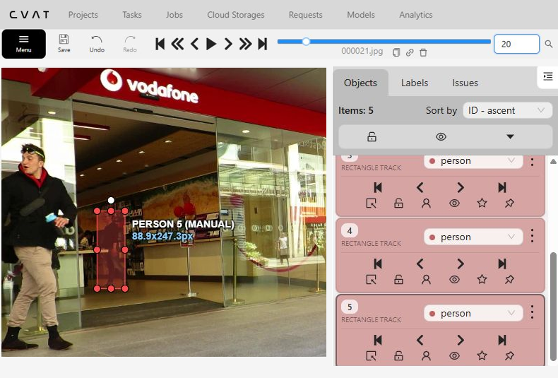
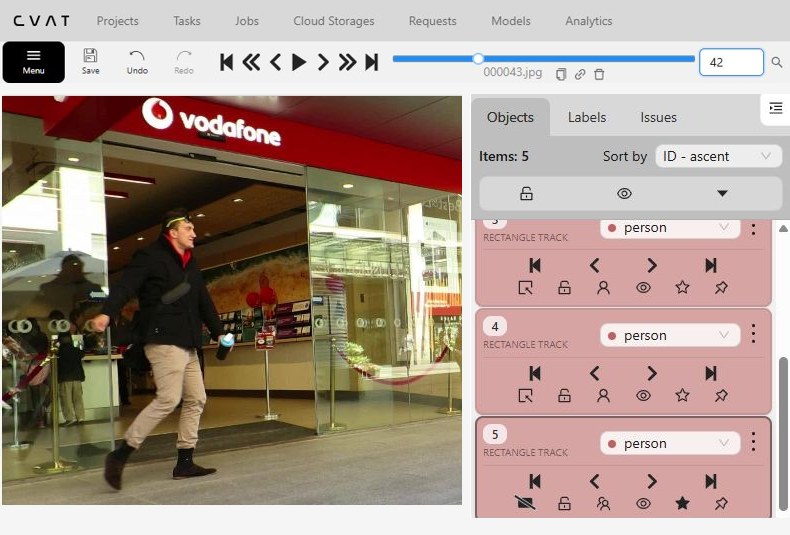
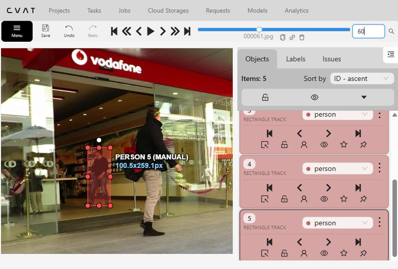
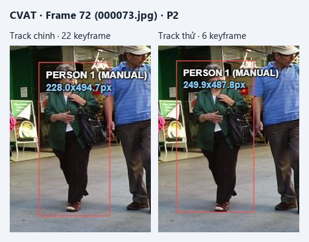

# Báo cáo cá nhân — Hoàng Trọng Trà (2A202603342)

Đoạn video: MOT17-09, 150 frame (frame 1–150), nguồn MOTChallenge, giấy phép CC BY-NC-SA 3.0.

## 0. Thông tin học viên

- Họ tên: Hoàng Trọng Trà
- MSSV: 2A202603342
- Mã đề (A/B/C): B
- Email: 26ai.traht@vinuni.edu.vn
- Link repository: https://github.com/trahoangdev/K5-L2B-Day05-HoangTrongTra-2A202603342-MOTTracking
- Giờ bắt đầu: 16:00
- Giờ kết thúc: 19:30

## 1. Xem trước đoạn video (CP0)

Ghi **trước khi vẽ**, mỗi người một dòng.

| Mã | Frame xuất hiện | Frame cuối thấy được | Rẽ / dừng / đổi tốc độ ở frame | Bị che ở frame | Ghi chú |
|---|---|---|---|---|---|
| P1 | 0 | 149 | 55-73 quay người về phía lối ra, 128-149 tiến gần camera. | 27-41 và 44-54 che một phần, 42-43 khuất hẳn. | Áo đen, quần jeans trong cửa hàng Vodafone. |
| P2 | 0 | 149 | 0-40 đi từ mép phải vào, 90-149 dịch sang trái và tiến gần camera. | Không thấy đoạn khuất rõ. | Áo khoác xanh lá, túi đen. Đi sát P3 ở đoạn cuối. |
| P3 | 0 | 149 | 0-60 đi từ mép phải vào, 100-149 tiến gần camera, box lớn nhanh. | Một phần cơ thể nằm ngoài mép phải ở đầu clip. | Áo xanh dương, mũ sáng. Vẫn thấy một phần ngay ở frame 0. |
| P4 | 0 | 147 | 0-40 dịch sang phải, 48–104 gần như đứng yên, 135-147 nhích sang trái. | 106-110, 135-140 và 143-147 che một phần. Khuất hẳn ở 111-134 và 148-149. | Bé mặc váy xanh nhạt, đứng cạnh P5. |
| P5 | 0 | 132 | 0-43 đi sang phải, 48-89 chậm lại và cúi nhìn P4. | Che một phần và bật `occluded` ở 101–104 và 124–132. Khuất hẳn ở 105-123 và 133-149. | Áo xanh xám, mang túi hồng, đi cùng P4. |

## 2. Keyframe và thời gian (CP1, CP4)

Số keyframe lấy từ kết quả `src/check_submission.py`.

| Mã | Số keyframe | Keyframe ở frame | Số frame có mặt | Keyframe / 100 frame | Thời gian (phút) | Chỗ khó |
|---|---|---|---|---|---|---|
| P1 | 23 | 0, 8, 16, 24, 27, 38, 44, 46, 54, 55, 56, 57, 58, 59, 65, 73, 81, 90, 101, 113, 128, 139, 149 | 148 | 15,5 |  15| Giữ box toàn thân khi bị che một phần. Đặt lại box khi thấy chân ở frame 44 và chỉnh khi P1 quay ra cửa. |
| P2 | 22 | 0, 1, 12, 20, 27, 36, 42, 48, 50, 54, 57, 60, 65, 72, 78, 82, 83, 87, 89, 91, 119, 149 | 150 | 14,7 |  17| Đi sát P3 ở đoạn cuối. Chỉnh box tại 119 và 149 để nội suy bám đúng người. |
| P3 | 15 | 0, 12, 20, 29, 38, 49, 60, 70, 81, 92, 101, 111, 123, 135, 149 | 150 | 10,0 |  25| Ban đầu chỉ thấy một phần ở mép phải. Box lớn nhanh khi tiến gần camera. |
| P4 | 59 | 0, 1, 2, 3, 4, 5, 6, 7, 8, 10, 11, 12, 13, 14, 15, 16, 17, 18, 20, 22, 23, 24, 25, 26, 27, 28, 31, 32, 33, 35, 36, 37, 38, 39, 40, 42, 46, 47, 48, 50, 52, 53, 54, 55, 57, 96, 105, 106, 110, 135, 138, 140, 141, 142, 143, 144, 145, 146, 147 | 124 | 47,6 |  23| Box nhỏ và dễ lẫn với người phía trước. Giữ cùng ID khi hiện lại ở 135. |
| P5 | 12 | 0, 8, 16, 30, 43, 56, 74, 89, 92, 101, 104, 124 | 114 | 10,5 |  18| Chỉ thấy một phần khi hiện lại ở 124–132, cần ước lượng box toàn thân. |
| **Tổng** | **131** | — | **686** | **19,1** | Chưa có tổng theo người | |

Keyframe / 100 frame của cả bài = tổng keyframe ÷ tổng số frame có mặt × 100 = 131 ÷ 686 × 100 ≈ **19,1 keyframe / 100 frame**.

Bạn đặt keyframe nhiều nhất ở người nào? Vì sao (người đó rẽ, dừng, lại gần camera hay bị che)?

P4 có nhiều keyframe nhất (59). Box của P4 nhỏ nên chỉ cần lệch vài pixel là đã cắt mất một phần đầu hoặc chân. Sau khi soát lại, các keyframe bổ sung giúp box bám theo từng bước và ôm sát P4 hơn khi bé hiện lại ở frame 135–141.

## 3. Đoạn bị che (CP2)

Người bị che: `P1` (track ID 5)

| Mốc | Frame |
|---|---:|
| Bắt đầu bị che một phần (bật `occluded`) | 27 |
| Mất hẳn (bật `outside`) | 42 |
| Hiện lại (tắt `outside`) | 44 |
| Thấy rõ trở lại (tắt `occluded`) | 55 |

- Thời gian khuất hẳn: 2 frame (42–43) ≈ 0,067 giây ở 30 fps.
- Quyết định: giữ cùng ID 5.
- Lý do (trả lời 3 câu: khuất bao lâu so với 60 frame, ngoại hình có khớp, chỗ hiện lại có đúng hướng và tốc độ):

P1 chỉ khuất hẳn 2 frame (42–43), dưới ngưỡng 60 frame. Khi thấy lại chân ở frame 44 rồi thấy rõ ở frame 55, áo đen và quần jeans vẫn khớp với P1 trước lúc khuất. Vị trí hiện lại gần vị trí trước khi khuất và chuyển động tiếp nối trong cửa hàng, nên giữ track ID 5.

Ảnh chụp từ CVAT tại frame 20, 42 và 60. Nguồn ảnh: MOT17, MOTChallenge (Milan et al., 2016).





## 4. Tự review ID (CP3)

Lượt 1 theo người (đi ngược từ frame 149 về 0 trên CVAT), lượt 2 theo cảnh (nhảy 10 frame). Ít nhất 3 dòng; không có lỗi thì ghi một dòng "đã kiểm hai lượt, không lỗi".

Loại lỗi dùng đúng một trong 7 mã: `id_switch`, `fragmentation`, `lost`, `merge`, `false_track`, `drift`, `flag`.

| Frame | Mã người | Loại lỗi | Mô tả một câu | Phát hiện ở lượt | Đã sửa? |
|---:|---|---|---|---|---|
| 8, 17, 27, 55 | P4 | `drift` | Mép trên của box cũ cắt một phần đầu P4 khi bé đi cạnh P5. | 1 (đối chiếu theo người) | Có. Đã nâng mép trên và bổ sung keyframe. |
| 135–141 | P4 | `drift` | Khi P4 hiện lại sau đoạn khuất, box cũ lệch sang phải so với vị trí của bé. | 1 (đối chiếu theo người) | Có. Đã chỉnh box sang trái và giữ cùng ID 3. |
| 101–103 | P5 | `flag` | Người áo xanh lá đi ngang che một phần thân P5, trong khi cờ `occluded` chỉ bật từ frame 104. | 2 (đối chiếu theo cảnh) | Có. Đã bật `occluded` từ frame 101 và kiểm tra cờ ở 101–104. |

Tổng hợp số lỗi theo loại:

| `id_switch` | `fragmentation` | `lost` | `merge` | `false_track` | `drift` | `flag` |
|---:|---:|---:|---:|---:|---:|---:|
| 0 | 0 | 0 | 0 | 0 | 2 | 1 |

Lỗi nào chỉ lượt 2 (theo cảnh) mới thấy, lượt 1 (theo người) không thấy? Vì sao?

Khi đối chiếu theo cảnh ở frame 101–103, thấy rõ P2 đi ngang trước P5 và che một phần thân P5. Việc nhìn cả hai người cùng lúc giúp nhận ra cờ `occluded` cần bật sớm hơn. Cột lượt kiểm ghi cách đối chiếu từng lỗi giữa hai bản gán của Job #14.

## 5. File xuất và kết quả tự kiểm (CP4)

| Kiểm tra | Kết quả |
|---|---|
| Tên file MOT 1.1 | HoangTrongTra_mot.zip |
| Tên file CVAT for video 1.1 | HoangTrongTra_cvat_video.zip |
| Số track ID khác nhau trong `gt/gt.txt` (phải là 5) | 5 |
| Frame `outside` không có dòng trong `gt.txt` (đúng / sai) | Đúng. Đã đối chiếu cả 5 track giữa XML và MOT. |
| Job đã completed trên CVAT máy cá nhân | Đã xác nhận `completed` trên CVAT. |

Dán phần tóm tắt in ra từ `src/check_submission.py`:

```text
=== Tóm tắt ===
  Lỗi: 0   |   Cảnh báo: 0
  Đạt. Dán phần tóm tắt này vào báo cáo mục 5.
```

## 6. Ba câu kết

1. Nếu được gán lại, bạn sẽ đặt keyframe khác ở đâu? Vì sao?

   Nếu gán lại, em sẽ đặt keyframe cho P5 ngay ở frame 101, lúc P2 đi ngang và che một phần thân P5. Em đã bổ sung mốc này trong lần soát cuối. Cờ `occluded` bật từ frame 101 đến 104 và box vẫn bao toàn thân ước lượng cho đến khi P5 khuất hẳn ở frame 105.

2. Có chỗ nào bạn không chắc "cùng ID hay ID mới"? Bạn đã quyết định và ghi chú thế nào?

   Ở frame 44, em chỉ thấy chân P1 nên cần xem tiếp đến frame 55 để đối chiếu. P1 khuất hẳn 2 frame (42–43), áo đen và quần jeans vẫn khớp, vị trí hiện lại cũng nối tiếp hướng di chuyển trước đó. Em giữ ID 5 và ghi các mốc mất hẳn, hiện lại và thấy rõ ở mục 3.

3. Một lỗi ID trong job của bạn (nếu không còn sót, chọn lỗi đã sửa) có thể làm xe tự lái dự đoán sai chuyển động của người đó như thế nào? Lỗi đó ảnh hưởng MOTA hay IDF1 nhiều hơn?

   Ở frame 135–141, box cũ của P4 lệch sang phải khi bé vừa hiện lại. Nếu dùng tâm box để ước lượng chuyển động, xe có thể dự đoán bé đang dịch sang phải nhiều hơn thực tế. Lỗi đã sửa trong job là `drift`. Nếu box lệch đến mức mất ghép với P4, cả MOTA và IDF1 đều có thể giảm. Nếu hệ thống gán P4 một ID mới sau đoạn khuất và giữ ID mới qua nhiều frame, IDF1 thường bị ảnh hưởng nhiều hơn vì nó xét tính nhất quán trên cả quỹ đạo. Trong MOTA, lần đổi ID đó được tính là một `IDSW`.

## Bonus (nếu làm)

### B1 — Hai người đi sát

...

### B2 — So cách đặt keyframe

| Cách đặt | Số keyframe | Frame trôi nhất | Ghi chú |
|---|---:|---:|---|
| Đều mỗi 30 frame | 6 | 72 | Frame 0, 30, 60, 90, 120 và mốc kết thúc 149. IoU thấp nhất là 0,788. |
| Theo chỗ đổi hướng | 22 | — | Track chính của P2 dùng làm tham chiếu và có keyframe tại frame 72. |

Em chọn P2 (ID 1 trong CVAT), người mặc áo xanh cầm túi đen. Em đặt box ở các mốc của track thử theo vị trí tương ứng trong track chính, có sai số làm tròn khi thao tác trên CVAT, rồi để CVAT tự nội suy các frame ở giữa. Em tính IoU giữa hai box trên cả 150 frame và lấy frame có IoU thấp nhất để đối chiếu. Bản xuất track thử nằm trong [HoangTrongTra_bonus_b2.zip](../../src/exports/HoangTrongTra_bonus_b2.zip).

Ở frame 72, tâm box thử lệch sang trái khoảng 25 pixel và box rộng hơn khoảng 22 pixel so với track chính. Nội suy tuyến tính giữa frame 60 và 90 giả định tâm box dịch chuyển và kích thước box thay đổi đều. Trong track chính, P2 dịch sang trái khoảng 23 pixel từ frame 60 đến 72, rồi khoảng 95 pixel từ frame 72 đến 90. Vì P2 dịch sang trái nhanh hơn ở đoạn sau, box nội suy đi sang trái quá sớm tại frame 72.



*Nguồn ảnh: MOT17, MOTChallenge (Milan et al., 2016).*

### B3 — So với tracker có sẵn

| Frame | Mã người | Tracker làm gì | Nhãn của bạn | Giải thích (đoán rồi sửa / ghép IoU / box score thấp / ngoại hình) |
|---:|---|---|---|---|
| | | | | |
| | | | | |

## 7. Tài liệu tham khảo và công cụ AI đã dùng